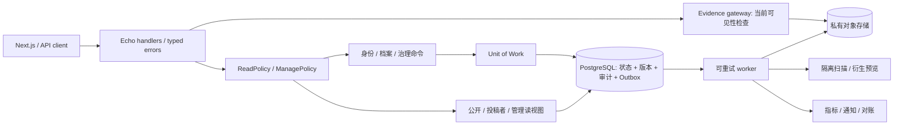

# UniBlack：可信治理与可靠性演进设计

> 日期：2026-10-02（Asia/Shanghai）。状态：提案，未批准、未实施。本文只新增设计，不修改代码、配置、既有 Goal 或产品决策。
> 配套审计与验收计划见 [审计报告](<../reports/2026-10-02-readonly-audit-and-validation.md>)（配套交付文件）。

## 1. 背景、目标与非目标

UniBlack 已有 Go/Echo/PostgreSQL 后端、Next.js 前端、迁移、证据存储、事件发布、申诉处罚和生产包装，不是从零搭建项目。现有体验深化已交付，不能把其已有功能再次列为缺失，参见 [体验交付报告](<../reports/product-experience-deepening.md#L14-L68>)。

产品应忠实表达“某社区在某时间对某账号作出的处理及依据”，而不是给人永久、全局、无法申诉的道德标签；这是 [README](<../../../README.md#L5-L8>) 已有定位。本提案把它深化为：**身份核验 + 带来源的事实记录 + 可逆的治理决定 + 可控的证据披露**。

目标：
1. 同一数据在公开 API、登录 API、版本历史、文件访问、归档中的披露规则一致。
2. 裁决、事件变化、版本、处罚、审计具有明确事务和幂等边界。
3. 可验证证据完整性、可恢复故障、可解释治理结果。
4. 在现有分层与技术栈中渐进演进，按收益而不是架构时髦程度排序。

非目标：本轮不落地任何修复；不删 Case 表；不实施 OAuth、API Key、暗色、OpenAPI 自动生成；不改变 demo captcha 锁定决策；不自动判定人物“恶意”；不默认改用微服务。

## 2. 现状、约束与证据等级

- **事实**：[产品决策](<../../product-decisions.md#L5-L17>) 锁定 Account + Event 主路径、2026-12-31 Sunset 和若干延后事项；下线检查窗口已进入 2026-10 → 2026-12。
- **事实**：[路线约束](<../../roadmap.md#L19-L69>) 固定 Go/Echo、GORM 读写、golang-migrate、PostgreSQL、Next.js，以及单向分层。
- **事实**：[事件服务](<../../../backend/internal/service/event.go#L22-L37>) 使用具体仓储依赖；[事件仓储](<../../../backend/internal/repository/event.go#L58-L87>) 已有发布事务。这意味着应扩展既有边界，而不是声称没有事务。
- **假设**：当前社区规模适合单 PostgreSQL 写入点；没有可靠 QPS、对象数量、包大小、运维人手或合规地域数据。本提案不虚构容量结论。
- **偏好**：先把安全与原子性做成可靠单体，再选读模型/异步任务，最后考虑跨社区与微服务。
- **待验证**：运行环境、实际分支/commit、当前测试通过率、生产流量与外部客户端；本会话没有命令执行工具，未运行测试。

## 3. 候选方案：让取舍可见

以下均是候选，不构成自动批准；成本为相对估计，不是工期承诺。

| 方向 | 解决什么 | 前提 | 代价 / 风险 | 建议 |
| --- | --- | --- | --- | --- |
| A. 加固现有分层单体 | 授权、披露、事务与错误映射不一致 | 现有部署继续适用 | 需要细化 service 命令边界 | 近期主线 |
| B. 模块化单体 + 端口接口 | 身份/档案/证据/治理相互渗透，难故障注入 | 按用例逐步提取接口 | 过细接口导致样板与导航成本 | A 后逐步做 |
| C. 单库轻量 CQRS | 公开 DTO 与管理员模型混用 | 有稳定公开披露契约 | 双读模型维护；不必另建数据库 | 近期可试 |
| D. Outbox + 后台 worker | 通知、索引、对象清理失败难恢复 | 接受可观察的最终一致性 | 重试/去重/死信/顺序处理 | 证据和归档优先 |
| E. CDC + 搜索索引 | 跨字段大规模查询慢 | 有实际查询瓶颈与运维能力 | CDC 积压、撤回传播延迟、索引泄露 | 基准测量后 |
| F. 只对治理决定事件溯源 | 决定历史、重放、解释性 | 稳定 command、版本和隐私删除策略 | 重放与模式演进复杂 | 小范围实验 |
| G. 全领域事件溯源 | 多系统投影与追溯 | 强历史需求和成熟团队 | 证据/个人信息不可变与删除义务冲突 | 保留但不默认 |
| H. 内容寻址证据 + 保管链 | 字节完整性、去重、来源变更 | 明确访问隔离与保留期限 | 哈希不是真实性；跨租户去重可泄露存在性 | 优先做链路，不急去重 |
| I. 隔离扫描/CDR worker | 危险文件、预览风险 | 私有原件区、预算与可接受延迟 | 误报；转换会改变字节；第三方扫描泄露隐私 | 本地隔离优先 |
| J. 独立证据服务 | 大文件吞吐/扫描与业务隔离 | 真正资源或团队边界 | RPC、鉴权、部署与一致性复杂 | worker 不够再拆 |
| K. 通用策略引擎（OPA/Cedar 等） | 多社区、多角色细粒度规则 | 策略量足够大、能维护版本 | 策略调试复杂；应用对象授权仍必需 | 先用显式领域策略 |
| L. 多租户单库 + RLS | 社区隔离与可复用托管 | tenant 模型与跨社区权限已明确 | 漏 tenant、连接池上下文污染 | 需专门 ADR |
| M. 每社区独立数据库/实例 | 高隔离、地域/恢复独立 | 愿意支付运维成本 | 全局查询/升级/备份复杂 | 托管产品候选 |
| N. 联邦社区签名声明 | 不依赖单一社区裁决、跨站互认 | 签名、信任策略、撤回协议 | 声誉污染、密钥失窃、撤回不及时 | 长期探索 |
| O. 透明日志 / Merkle checkpoint | 证明历史决定未静默篡改 | 可以设计公开/私有承诺边界 | 永久泄露风险；透明不代表裁决正确 | 治理摘要可实验 |
| P. 离线签名快照 | 下游可离线核验、故障时读 | TTL、签名轮换、撤回版本明确 | 过期名单导致错误拒绝 | 不提供永久静态黑名单 |
| Q. Serverless 异步任务 | 低频归档/扫描弹性 | 合适地区、成本和供应商约束 | 冷启动、对象出口费、凭证管理 | 可替换 worker 执行器 |
| R. 湖仓/分析仓 | 治理质量、延迟、申诉趋势分析 | 去标识与分析需求已明确 | 额外副本扩大敏感数据面 | 先 SQL 指标 |
| S. 人工智能辅助整理 | OCR、重复材料候选、摘要辅助 | 授权、隔离、人工复核 | 幻觉、隐私、注入、偏见；禁止自动处罚 | 仅辅助，不自动定案 |
| T. 风险分数替换为解释卡 | 读者不把等级误当概率/判罪 | 社区能说明评级来源 | 更复杂的信息架构 | 产品主线候选 |

## 4. 推荐架构与理由

推荐 A + 小规模 B/C + 按需 D：保留单体，新增用例级政策与事务边界；公开视图不再直接依赖完整 ORM 模型；文件下载不是 storage URL 的直接透传。接口抽象围绕授权策略、事务单元、对象存储与任务调度，避免“一张表一个新微服务”。

图为建议目标，worker、gateway、Unit of Work 不是声称已实现。Outbox 保障 DB 与“待执行任务”的原子记录，**不把对象存储操作变成 DB 原子事务**。

### 4.1 授权与披露：一套政策，多种投影

策略输入：requester、角色/权限、归属、对象状态、父级 Subject 状态、证据披露级别、处理目的。先定义允许矩阵，再编码；客户端守卫不是安全边界。

建议读视图：
- Public：公开账号字段、当前可披露 Event、脱敏/受控证据元数据、公开更正摘要。
- Submitter：本人材料和流程状态；不因此获得其他投稿者或审核内部信息。
- Moderator：所需原件、裁决工具、保管链；访问应可审计。
- Admin：系统运营与配置；是否兼任裁决权限需显式说明。

不可见默认不返回；404/403 的选择按存在性披露策略固定。列表、详情、版本、搜索、统计、归档与下载都必须走同一可见性契约；subject.active 并不自动说明所有子事件均公开。建议 `notes` 默认内部字段，`custom_attributes` 要有平台 schema/字段披露白名单，不能一股脑公开。

### 4.2 治理事务、竞争与版本

现有正式 Event 申诉路径已经实现事务、Appeal 行锁、pending 检查和后果审计，见 [正式裁决仓储](<../../../backend/internal/repository/appeal.go#L119-L172>)；不要重做或否定这部分。缺口主要是旧 review 旁路、处罚申诉和版本历史的边界不统一。

目标是让所有裁决命令都在短事务内：锁定或条件更新 pending Appeal → 验证 Event version → 保存前后快照 → 更新 Event → 必要时建唯一关联处罚 → 写 Audit/Outbox → 提交。外部邮件、文件扫描不放进事务。

并发方案对比：
- `FOR UPDATE`：简单串行裁决；统一锁顺序、锁超时、死锁重试，不持锁等待用户输入。
- 乐观版本 CAS：冲突明确返回 409，适合读多写少；所有写入口必须带相同 version 协议。
- Serializable：覆盖更广不变量；必须处理重试，不能当作“无需业务幂等”的替代。

建议先用行锁或 CAS；同一 Appeal 只产生一个终局决定，重复请求返回已有结果或冲突。版本号不能无锁 `MAX+1`；ChangedBy 应表示此次变更者而不是原投稿者。业务 Event 是领域记录，不能仅因名称叫 Event 就当成事件溯源实现。

### 4.3 证据安全与保管链

建议生命周期：`staged → validated/quarantined → attached → disclosed/restricted → retention_pending → purged`。原件和脱敏预览分别记录 hash、版本、处理者、转换规则，保留衍生关系。哈希证明当前字节与声明一致，不证明截图或指控真实。

访问方案：应用代理下载（实时撤回、限流最直观）与短 TTL 签名 URL（降低应用带宽，但撤回有残余 TTL 窗口）并列；公开源站静态文件不适合作为受保护原件通道。预览内容用隔离源站、保守 MIME、nosniff 与下载 disposition；危险格式不要同源内联。

存储一致性：上传以随机 operation ID 建 staged 记录；DB 引用成功后状态推进；失败留下可重试清理任务；清理需检查当前引用、年龄宽限和进行中租约。不可仅列 bucket 后“没查到记录就删除”。删除先提交 tombstone/任务，再物理回收，保留审计而非原件敏感内容。

### 4.4 身份不是简单的字符串去重

账号 identity 应优先平台不可变 account ID；username 应能重命名、回收、区分大小写，规范化规则要按平台定义，而不是所有平台都 lower-case。Subject 合并/拆分要成为可审查命令，并保留账号绑定的有效期与来源；不能因相似昵称就推断同一个自然人。

建议档案显示“查询值匹配了哪个账号、是精确 ID 还是昵称、社区/决定日期、证据可用性、更正/申诉状态”，避免只有一个红色风险分数。未来双时态可区分事件发生时间、账号归属时间与系统记录时间，但须有真实需求再引入。

### 4.5 前端与治理体验

继续维持页面 → API client → Provider 边界。近期不擅自切 Cookie/BFF；若后续讨论 HttpOnly 必须同时设计 CSRF、同站策略、退出/撤销与服务端边界。

建议：单一 session 状态机与刷新 single-flight；版本冲突让裁决者查看差异再确认；危险动作保留逐项确认，不未经讨论改成批量裁决；“更正”必须区分改正文与只附说明。证据应有真实可用下载渠道，无渠道时明确展示“元数据可见、原件需申请”，而不是假装可点击。

## 5. 路线与验收门槛

日期是建议窗口，能力与安全证据优先于日历，不承诺未批准功能。

| 阶段 | 建议窗口 | 交付 | 退出条件 |
| --- | --- | --- | --- |
| R0：基线复核 | 2026-10 上旬 | commit/环境/测试报告；角色与披露矩阵 | 审计项逐项复现或排除，不以历史通过数代替本次结果 |
| R1：边界封口 | 2026-10 | 对象修改授权、隐藏对象读、版本与文件访问、session 安全设计 | 普通用户不能跨对象写；隐藏材料所有通道不可泄露 |
| R2：治理原子性 | 2026-10 至 11 | 裁决 UoW、版本/审计、幂等、故障注入 | 并发仅一终局；任一步失败无半裁决 |
| R3：证据可靠性 | 2026-11 | private gateway、暂存清理、配额、归档快照 | 取消/崩溃/删除失败可恢复；无活动引用误删 |
| R4：兼容退役 | 2026-10 至 12 | 流量盘点、公告、双读对账、备份恢复 | 原有 Sunset checklist 全部有证据；到期不自动删表 |
| R5：可信体验 | R1/R2 后 | 解释卡、匹配理由、更正差异、可达性 | 用户能区分事实/处理/争议/未知；键盘与屏幕阅读验收 |
| R6：扩展实验 | 实际需求后 | 签名快照、联邦声明/透明摘要 PoC | 独立 ADR、成本预算、隐私与撤回测试；不替换主线 |

工程拆分建议：每个阶段先测试规格 PR，再单问题 fix PR，再设计增强 feature PR；文档用 docs/ 分支，不直接提交 main。涉及 DB 用追加 up/down 迁移；“可以 rollback”不代表删除敏感数据后可恢复，应区分 schema 回滚和业务恢复。

## 6. 风险、度量与待验证问题

建议候选指标：跨权限失败率、隐藏对象错误公开数（目标 0）、半裁决数（目标 0）、版本缺口数、孤儿/缺失对象数、任务最长积压、撤回传播时间、申诉受理/裁决时延、归档恢复成功率。延迟 SLO 与 RPO/RTO 数字须有容量/产品输入后确定。

优先澄清（不阻塞本轮文档交付）：
1. P0：对象/账号/证据谁可以修改和删除？撤回后公开保留摘要还是完全隐藏？
2. P0：是否实际面向生产开放？证据是否包含手机号、聊天原文、未成年人信息？合规地域/保留义务需专业确认。
3. P1：“corrected”意味着正文变更、附注还是撤销旧主张？subject 的 active/其他状态确切语义是什么？
4. P1：实际数据/请求/最大归档规模、运营人手、恢复容忍时间是多少？
5. P2：复用定位是独立部署、托管多租户还是联邦互通？三者的安全成本不同。

## 7. 参考依据与可信度

- [OWASP File Upload Cheat Sheet](https://cheatsheetseries.owasp.org/cheatsheets/File_Upload_Cheat_Sheet.html)：已抓取全文，成熟安全实践，高可信；支持授权下载、文件类型纵深防御、解压后限额与隔离扫描。不是项目已遭攻击的证据。
- [PostgreSQL Explicit Locking](https://www.postgresql.org/docs/current/explicit-locking.html)：已抓取官方全文，高可信；行锁、锁顺序与死锁策略。抓取为当前版本文档，落地时核对部署 PG 版本，不要求升级数据库。
- [AWS Transactional Outbox](https://docs.aws.amazon.com/prescriptive-guidance/latest/cloud-design-patterns/transactional-outbox.html)：已抓取官方全文，高可信；借鉴双写与消费者幂等模式，不绑定 AWS。不能据此宣称对象操作 exactly-once。
- PROV / 透明日志 / 联邦声明：本文仅借用来源与衍生关系的设计思想；本轮 W3C PROV 页面抓取失败，未将其列为已核验规范或强制依赖。

这些参考支撑设计取舍，具体缺陷仍由配套审计的本地代码证据证明。
